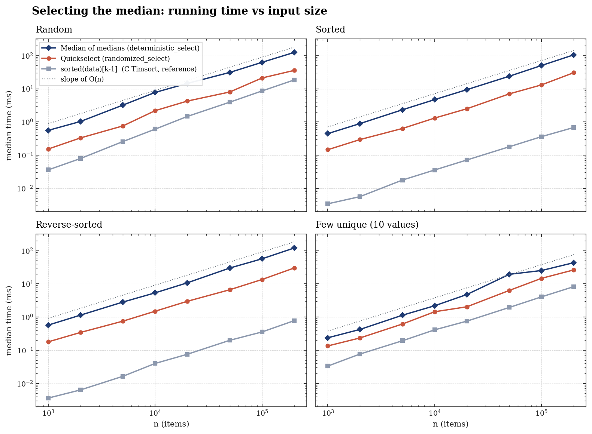
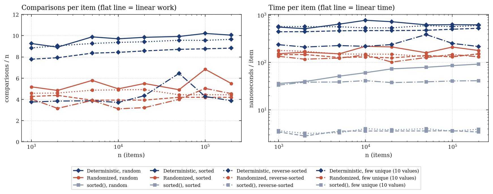
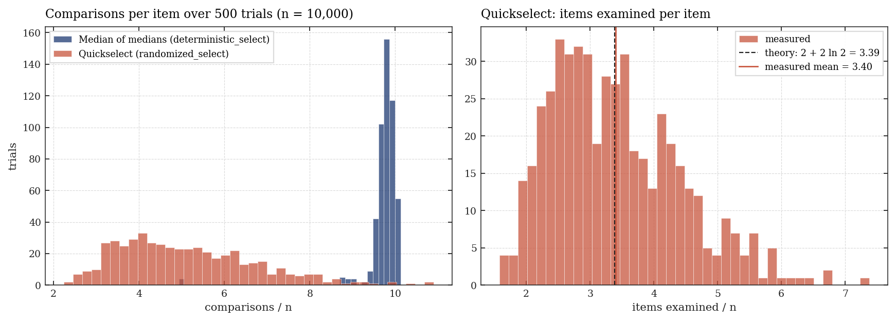
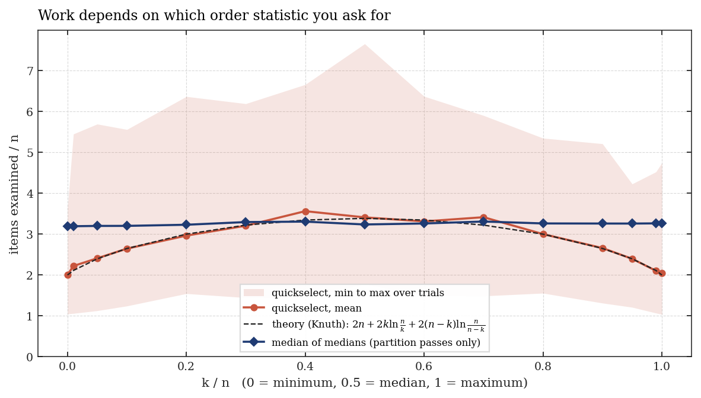
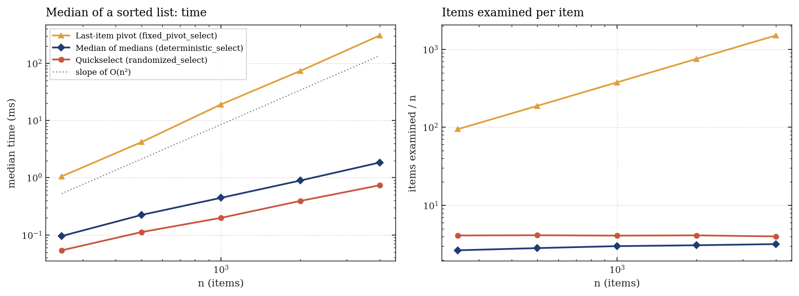
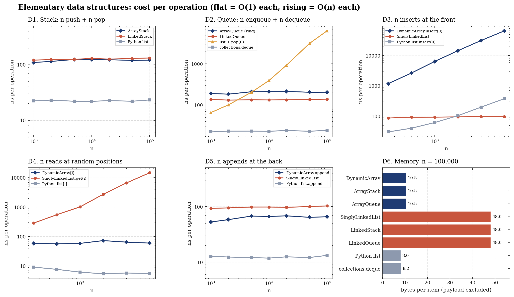

# Medians and Order Statistics & Elementary Data Structures

MSCS532 Assignment 6

I ran everything with Python 3.13.9 on an Apple Silicon Mac. Every number in this report comes
from [`results/benchmark_output.txt`](results/benchmark_output.txt), which you can regenerate
with `python3 run_benchmarks.py` (about 35 seconds). Inputs and random pivots use fixed seeds
(532 and seeds derived from it), so the comparison counts come out exactly the same every run.
Timings move by a few percent from run to run.

## Contents

**Part 1: Selection algorithms**

1. [Implementation](#1-implementation)
2. [Performance analysis](#2-performance-analysis)
3. [Empirical analysis](#3-empirical-analysis)

**Part 2: Elementary data structures**

4. [Implementation](#4-implementation)
5. [Time complexity of each operation](#5-time-complexity-of-each-operation)
6. [Arrays vs linked lists for stacks and queues](#6-arrays-vs-linked-lists-for-stacks-and-queues)
7. [Comparing structures in specific scenarios](#7-comparing-structures-in-specific-scenarios)
8. [Practical applications](#8-practical-applications)

9. [Conclusions](#9-conclusions)
10. [References](#10-references)

---

# Part 1: Selection algorithms

The *k*-th order statistic of a list is the item that would sit at position *k* if the list
were sorted (*k* = 1 is the minimum, *k* = *n* the maximum, *k* = ⌈*n*/2⌉ the lower median).
Sorting first and indexing gives the answer in O(*n* log *n*). Both algorithms below do it in
O(*n*): one guarantees it, the other gets it on average.

## 1. Implementation

All the code is in [`selection.py`](selection.py). I followed SELECT and RANDOMIZED-SELECT from
Cormen et al. (2022, ch. 9). Like the book, *k* is 1-based. Internally everything is 0-based
with inclusive ranges `a[lo..hi]`.

| Function | Pivot | Guarantee |
|---|---|---|
| `deterministic_select(items, k)` | median of the medians of groups of 5 | O(*n*) worst case |
| `randomized_select(items, k, rng=None)` | a uniformly random item of the range | O(*n*) expected, O(*n*²) worst case |
| `fixed_pivot_select(items, k)` | always the last item (baseline only) | O(*n*²) on sorted input |
| `median(items, method=...)` | lower median via either of the first two | |

All three share one partition function and accept an optional `SelectTracker`, which counts
comparisons, items examined, partition passes and recursion depth.

### 1.1 Shared building block: three-way partition

```python
def three_way_partition(a, lo, hi, pivot):
    lt, i, gt = lo, lo, hi
    while i <= gt:
        value = a[i]
        if value < pivot:
            a[lt], a[i] = value, a[lt]; lt += 1; i += 1
        elif pivot < value:
            a[i], a[gt] = a[gt], value; gt -= 1
        else:
            i += 1
    m = hi - lo + 1
    return lt, gt, 2 * m - (lt - lo)
```

This is Dijkstra's "Dutch national flag" partition. Afterwards `a[lo..lt-1] < pivot`,
`a[lt..gt] == pivot`, and `a[gt+1..hi] > pivot`. Every item is looked at exactly once, so one
pass is Θ(*m*) time and O(1) extra space. An item below the pivot costs one comparison and any
other item costs two, which means the exact count is `2m − (number below)`. I compute that at
the end, so the loop needs no counter.

I partition three ways instead of the textbook's two for two reasons, and both are about
**duplicates**:

1. **Early exit.** If position *k* lands in the `==` block, that block is the answer and we
   stop. With only a few distinct values this finishes after one or two passes (section 3.3).
2. **The worst-case proof needs it.** The median-of-medians guarantee says at least ~3*n*/10
   items are ≥ the pivot and at least ~3*n*/10 are ≤ it. With a two-way partition, items equal
   to the pivot all go to one side. On a list of *n* copies of the same value that side has
   *n* − 1 items, and the "guaranteed linear" algorithm turns quadratic. With three-way
   partitioning, the copies go into the middle block, which is never recursed on. The bound in
   section 2.1 then holds for any input.

### 1.2 Deterministic selection (median of medians)

```python
def _mom_select(a, lo, hi, target, tracker, level):
    while True:
        if hi - lo + 1 <= 5:
            insertion_sort_range(a, lo, hi)
            return a[target]
        # 1. sort each group of 5, move its median to the front of the range
        slot = lo
        for start in range(lo, hi + 1, 5):
            end = min(start + 4, hi)
            insertion_sort_range(a, start, end)
            mid = (start + end) // 2
            a[slot], a[mid] = a[mid], a[slot]
            slot += 1
        # 2. recursively find the median of those medians
        count = slot - lo
        pivot = _mom_select(a, lo, slot - 1, lo + (count - 1) // 2, tracker, level + 1)
        # 3. partition around it and keep only the side holding target
        lt, gt, _ = three_way_partition(a, lo, hi, pivot)
        if target < lt:   hi = lt - 1
        elif target > gt: lo = gt + 1
        else:             return pivot
```

(Tracker bookkeeping removed for clarity.) Design choices:

* **In place.** The group medians are swapped into `a[lo..count-1]` instead of being copied
  into a new list. `slot` moves forward 1 per group while `start` moves 5, so `slot ≤ start`
  always. That means we only ever overwrite positions in groups we've already finished with.
  The recursive call then works on that prefix in place.
* **Loop instead of tail recursion.** "Recurse into the side that holds *k*" is the last thing
  the algorithm does, so it's a `while` loop. The only real recursion is step 2, on a list 5×
  smaller, which keeps the stack depth at about log₅ *n* (section 2.1).
* **Insertion sort for groups.** A group of ≤ 5 items takes at most 10 comparisons, so it's
  O(1) per group, and insertion sort is the cheapest way to do it.
* **The partial last group** (when 5 doesn't divide the range) uses its lower median. The proof
  already allows for this with its "−6" term.

### 1.3 Randomized selection (quickselect)

```python
def _quickselect(a, target, choose_pivot, tracker):
    lo, hi = 0, len(a) - 1
    while lo < hi:
        pivot = a[choose_pivot(lo, hi)]       # rng.randint(lo, hi)
        lt, gt, c = three_way_partition(a, lo, hi, pivot)
        if target < lt:   hi = lt - 1
        elif target > gt: lo = gt + 1
        else:             break
    return a[target]
```

This is Hoare's FIND (1961) with a random pivot and the same three-way partition. It's fully
iterative, so it uses O(1) extra space. `fixed_pivot_select` is the same loop with
`choose_pivot = lambda lo, hi: hi`. I added it only so the benchmark can show what the random
pivot buys.

### 1.4 Other choices and edge cases

* **The input isn't changed** by default: each function works on `list(items)`. Pass
  `copy=False` to skip that O(*n*) copy and let the function reorder your list. In that case
  the answer also ends up at index *k* − 1, with smaller items before it and larger items after
  it, as a side effect.
* **Values only need `<`**, so ints, floats, strings and tuples all work.
* **Bad arguments** raise errors: an empty list or *k* outside 1..*n* raises `ValueError`, and a
  non-int *k* (including `True`) raises `TypeError`.
* **Tests.** [`test_selection.py`](test_selection.py) has 20 tests. They check every *k* on
  lists of many sizes (including all n ≤ 7, and 25/26, where group boundaries change),
  heavy-duplicate and all-equal lists, sorted and reversed lists, floats, strings and tuples,
  and that the input isn't mutated. They also check the analysis: work stays below 20*n* on 5
  input shapes, recursion depth stays within log₅ *n* + 1, `fixed_pivot_select` is quadratic on
  sorted input, and `randomized_select` isn't.

## 2. Performance analysis

### 2.1 Deterministic selection: O(*n*) in the worst case

Let *x* be the median of the ⌈*n*/5⌉ group medians. At least half of the groups have a median
≥ *x*. Each of those groups, except possibly *x*'s own group and the short last group, holds at
least 3 items ≥ *x*: its median and the two items above the median. So

  #(items ≥ *x*) ≥ 3 · (⌈½⌈*n*/5⌉⌉ − 2) ≥ 3*n*/10 − 6.

So at most 7*n*/10 + 6 items are **strictly less** than *x*. By the symmetric argument, at most
7*n*/10 + 6 are **strictly greater**. The three-way partition only ever keeps the strictly-less
or the strictly-greater side, because items equal to *x* end the search, so the remaining range
has at most 7*n*/10 + 6 items. This holds **for every input, duplicates included**. Each step
costs:

| Step | Cost |
|---|---|
| Sort ⌈*n*/5⌉ groups of ≤ 5 | O(*n*) (≤ 10 comparisons per group) |
| Find the median of medians recursively | *T*(⌈*n*/5⌉) |
| Partition | O(*n*) |
| Continue on one side | ≤ *T*(7*n*/10 + 6) |

  *T*(*n*) ≤ *T*(⌈*n*/5⌉) + *T*(7*n*/10 + 6) + *an*.

**Why this is linear.** Guess *T*(*n*) ≤ *cn* and substitute:

  *T*(*n*) ≤ *c*(*n*/5 + 1) + *c*(7*n*/10 + 6) + *an* = 9*cn*/10 + 7*c* + *an*.

That's ≤ *cn* whenever *cn*/10 − 7*c* ≥ *an*, which holds for *n* ≥ 140 and *c* ≥ 20*a*.
(Smaller *n* are covered by choosing *c* large enough.) The key fact is **1/5 + 7/10 = 9/10
< 1**: the two recursive calls together work on less than the whole input, so the work at each
level of the recursion tree shrinks geometrically (*n*, 0.9*n*, 0.81*n*, …). The total is at
most 10× the top level. With groups of 3 the sum would be 1/3 + 2/3 = 1. Every level would then
cost the full *n*, and you'd get Θ(*n* log *n*). Five is the smallest odd group size that works.

**The constant is big, and the measurements show it.** Sorting a group of 5 random items takes
about 7.7 comparisons on average (1 + 5/3 + 9/4 + 14/5), or 1.54 per item. The partition adds
about 1.5 per item. Both costs come back at every level of both recursions. Measured over 500
random inputs, `deterministic_select` uses **9.7 comparisons per item** (sd 0.48), against 5.1
for quickselect (section 3.4).

**Space.** O(1) extra per call, and the only real recursion is step 2. That gives a stack depth
of log₅ *n* + O(1). The tracker measured depth 7 at *n* = 100,000 (log₅ 10⁵ ≈ 7.2). The
default copy adds O(*n*) on top; `copy=False` removes it.

### 2.2 Randomized selection: O(*n*) expected

The pivot is uniformly random, so its rank *q* among the current *m* items is uniform on
1..*m*, **whatever order the input is in**. After the pass we keep at most max(*q* − 1, *m* −
*q*) items. Following CLRS (§9.2), write *T*(*m*) for the expected work:

  E[*T*(*n*)] ≤ (1/*n*) Σ<sub>*q*=1..*n*</sub> E[*T*(max(*q* − 1, *n* − *q*))] + *an*
       ≤ (2/*n*) Σ<sub>*j*=⌊*n*/2⌋..*n*−1</sub> E[*T*(*j*)] + *an*.

Substituting E[*T*(*j*)] ≤ *cj* gives E[*T*(*n*)] ≤ *c*(3*n*/4 + 1/2) + *an*. That's ≤ *cn*
whenever *n*(*c*/4 − *a*) ≥ *c*/2, which holds for any *c* > 4*a* once *n* ≥ 2*c*/(*c* − 4*a*).
So E[*T*(*n*)] = O(*n*).

Here's the intuition. With probability 1/2 the pivot lands in the middle half of the ranks, and
then at least 1/4 of the range is thrown away. So on average it takes 2 passes to shrink the
range by a factor of 3/4. Total expected work is about 2*n*(1 + 3/4 + (3/4)² + …) = 8*n*. That's
a loose bound, but plainly linear.

**The exact expectation.** Knuth (1971) derived the expected number of items examined:

  E[*C*(*n*, *k*)] ≈ 2*n* + 2*k* ln(*n*/*k*) + 2(*n* − *k*) ln(*n*/(*n* − *k*)).

It's 2*n* for the minimum or maximum and peaks at the median, at **2*n*(1 + ln 2) ≈ 3.386*n***.
The benchmark checks this directly (sections 3.4 and 3.5). The measured mean over 500 runs was
3.403*n*.

**Worst case.** Still Θ(*n*²): if every pivot happened to be the largest remaining item, each
pass would remove one item. For random pivots this is astronomically unlikely. A pass shrinks
the range to ≤ 3/4 of its size with probability ≥ 1/2, so needing many more passes than
expected has exponentially small probability. In 500 trials the worst run examined 7.4*n*, about
2.2× the mean. Since no input can make a bad pivot sequence likely, an adversary who knows the
code still can't force the bad case.

**Space.** The loop is iterative, so it uses O(1) extra space plus the optional O(*n*) copy.
There's no recursion, so the stack depth is 0.

### 2.3 Fixed pivot, for contrast

With `pivot = a[hi]` on a sorted list, every pivot is the largest remaining item. Finding the
median then removes one item per pass for *n*/2 passes and examines Σ *m* ≈ 3*n*²/8 items. That's
Θ(*n*²). The benchmark measures exactly 1500.8*n* examined at *n* = 4000, and 3*n*/8 = 1500.
Sorted and nearly-sorted inputs are common in practice, which is why a fixed pivot isn't used.

### 2.4 Summary and overheads

| | Deterministic | Randomized |
|---|---|---|
| Worst-case time | **Θ(*n*)** | Θ(*n*²) (probability → 0) |
| Expected time | Θ(*n*) | **Θ(*n*)** |
| Measured comparisons / *n* (random input, median) | ~9.7–10.2 | ~4.8–6.8 (mean 5.1) |
| Run-to-run spread | tiny (input-dependent only) | sd ≈ 1.6*n* comparisons |
| Extra space | O(log *n*) stack | O(1) |
| Other overheads | sorting groups, the extra recursive call, swapping medians | one `randint` per pass (~log *n* passes, negligible) |
| Depends on input order? | No | No |
| Easy to implement? | Fiddly (group bookkeeping, the recursion) | About 10 lines |

---

## 3. Empirical analysis

### 3.1 Setup

* **Sizes**: *n* = 1,000 to 200,000. **Inputs**: random integers in [0, 10*n*), sorted,
  reverse-sorted, and "few unique" (random integers in 0..9). *k* = lower median, the hardest
  case for quickselect.
* For each (input, *n*, algorithm) I report the **median of 5 timed runs** with the garbage
  collector off. Each randomized run uses a different seed. Timings include the O(*n*) input
  copy for all algorithms, so the comparison is fair.
* As a reference I also timed `sorted(data)[k-1]`, which is CPython's Timsort, written in C.
* Comparison counts come from `SelectTracker` and don't depend on machine speed.





### 3.2 Both algorithms scale linearly

On a log-log plot both algorithms run parallel to the O(*n*) guide line on all four inputs.
The per-item view is clearer: time per item and comparisons per item both stay flat as *n* grows
200-fold. On random input:

| *n* | Deterministic | cmp/*n* | Randomized | cmp/*n* | `sorted()` |
|---:|---:|---:|---:|---:|---:|
| 1,000 | 0.56 ms | 9.26 | 0.15 ms | 5.18 | 0.04 ms |
| 10,000 | 7.78 ms | 9.71 | 2.19 ms | 4.99 | 0.61 ms |
| 100,000 | 62.8 ms | 10.21 | 21.2 ms | 6.84 | 8.6 ms |
| 200,000 | 124.7 ms | 10.05 | 35.8 ms | 5.49 | 18.5 ms |

Doubling *n* from 100k to 200k roughly doubles both selection times. Deterministic selection is
consistently **3.0 to 4.5× slower** than randomized on random, sorted and reversed input, at
every size. That's the
constant-factor cost predicted in section 2.1: about twice the comparisons, plus the extra work
of sorting groups, swapping medians and the second recursion.

The randomized comparison counts jump around (4.8 to 6.8 per item) because each data point
reflects only 5 random runs. The deterministic counts form a smooth, slowly rising curve (8.9 to
10.2). It approaches its limit from below because a small list finishes in a few levels, before
the geometric sum is complete.

### 3.3 Effect of input distribution

| Input (*n* = 200,000) | Deterministic | cmp/*n* | Randomized | cmp/*n* |
|---|---:|---:|---:|---:|
| Random | 124.7 ms | 10.05 | 35.8 ms | 5.49 |
| Sorted | 105.3 ms | 8.83 | 30.5 ms | 4.19 |
| Reverse-sorted | 120.6 ms | 9.66 | 30.1 ms | 4.43 |
| Few unique | 43.5 ms | 3.87 | 26.3 ms | 4.54 |

* **Neither algorithm degrades on sorted or reverse-sorted input.** That's the point of both
  designs. For quickselect the pivot is random, so the input order is irrelevant. The fixed-pivot
  version, by contrast, gets ~410× slower on sorted input already at *n* = 4,000 (section 3.6).
* Deterministic selection is a bit **cheaper on sorted input** (8.8 vs 10.1 comparisons per
  item). Its groups of five are already sorted, so insertion sort does 4 comparisons per group
  instead of ~7.7.
* **Few unique values** helps both, and helps the deterministic version most (3.9 vs 10
  comparisons per item). With only 10 values, the median's value fills ~10% of the list.
  After one or two passes the target position falls inside the `==` block and the search
  stops. This is the early exit from section 1.1 at work. A two-way partition would keep
  recursing on these copies.

### 3.4 Run-to-run variation

Next I ran 500 trials with *n* = 10,000, each on a fresh random input, and for quickselect a
fresh seed too:

| | cmp/*n* mean | sd | min | max | examined/*n* mean |
|---|---:|---:|---:|---:|---:|
| Deterministic | 9.738 | 0.479 | 4.932 | 10.124 | 3.159 |
| Randomized | 5.111 | 1.592 | 2.236 | 10.898 | **3.403** (theory 3.386) |



This is the practical difference between a worst-case and an expected-case bound.
Deterministic selection is tightly concentrated: almost every run uses 9.5–10.1*n* comparisons.
The low outliers are runs where an early pivot happened to equal the answer. Quickselect is
**twice as cheap on average but 3.3× more variable**, with a long right tail. Its worst run
(10.9*n*) roughly matched a typical deterministic run. The measured mean number of items
examined, 3.403*n*, is within 0.5% of Knuth's 2 + 2 ln 2 = 3.386.

### 3.5 Effect of *k*

For each *k* I ran 100 randomized trials on one random list of *n* = 50,000:



The quickselect mean follows Knuth's curve closely. It's 2.00*n* at *k* = 1 (theory 2.00),
3.41*n* at the median (theory 3.39) and 2.05*n* at *k* = *n* (theory 2.00). Deterministic
selection stays at ~3.2*n* examined (~10*n* comparisons) **for every *k***. Its pivot is chosen
without regard to *k*, so asking for the minimum costs as much as asking for the median. If you
only need extremes or near-extremes, quickselect's advantage is even bigger, and a plain linear
scan (*n* − 1 comparisons) beats both.

### 3.6 What the random pivot buys

The median of a sorted list, with three different pivot choices:

| *n* | Fixed pivot | examined/*n* | Randomized | examined/*n* | Deterministic | examined/*n* |
|---:|---:|---:|---:|---:|---:|---:|
| 250 | 1.06 ms | 94.5 | 0.05 ms | 4.11 | 0.10 ms | 2.65 |
| 1,000 | 19.0 ms | 375.8 | 0.20 ms | 4.09 | 0.44 ms | 3.00 |
| 4,000 | **305.3 ms** | **1500.8** | 0.74 ms | 3.99 | 1.84 ms | 3.19 |



The fixed pivot's examined/*n* grows linearly with *n* (exactly 3*n*/8, as computed in section
2.3), and its time grows ~4× every time *n* doubles: quadratic. The other two stay flat.

### 3.7 The `sorted()` reference

Pure-Python linear-time selection **loses to C's O(*n* log *n*) Timsort** at every size tested:
18.5 ms vs 35.8 ms (randomized) vs 124.7 ms (deterministic) on 200,000 random items. On sorted input
Timsort detects the single ascending run and finishes in O(*n*), well under a millisecond. This
doesn't contradict the theory. Big-O hides constant factors, and here the constant includes
roughly a 50–100× gap between one interpreted Python operation and one C operation. The
asymptotics still show: Timsort's time per item on random data rises from 36 ns to 92 ns over
the tested range (the log *n* factor), while quickselect's stays roughly flat at 150–220 ns, with no upward trend. At much
larger *n* the curves would eventually cross. In a compiled language (C++'s
`std::nth_element` is introselect) selection beats sorting at every practical size.

### 3.8 How the results relate to the theory

| Prediction | Observed |
|---|---|
| Both are linear | Flat time/*n* and comparisons/*n* over a 200× range of *n*, on all four inputs |
| Deterministic doesn't depend on input order or *k* | 8.8–10.1 cmp/*n* for every ordering, ~3.2*n* examined for every *k* |
| Randomized doesn't depend on input order | 4.2–5.5 cmp/*n* on random, sorted and reversed input |
| Randomized expected work is 2*n*(1 + ln 2) at the median | Measured 3.403*n* vs 3.386*n* |
| Randomized work follows Knuth's formula in *k* | Within ~0.22*n* at every *k* tested |
| Deterministic has a larger constant | 3.0–4.5× slower, ~2× the comparisons |
| Worst-case guarantee only for deterministic | sd 0.48*n* vs 1.59*n*; quickselect's worst run ≈ deterministic's typical run |
| Fixed pivot is Θ(*n*²) on sorted input | Examined exactly 3*n*²/8 |
| Recursion depth is log₅ *n* | Depth 7 at *n* = 10⁵ |

**Which one to use?** Use randomized quickselect by default: it's simpler and roughly 3–4× faster. Use
median of medians when a worst-case bound actually matters, for example real-time systems or
inputs chosen by an adversary. Better still, use the hybrid that libraries ship ("introselect"):
run quickselect, and switch to median of medians only if it isn't making progress. That gives
quickselect's speed and median of medians' guarantee.

---

# Part 2: Elementary data structures

## 4. Implementation

All the code is in [`data_structures.py`](data_structures.py). It's tested by
[`test_data_structures.py`](test_data_structures.py) (21 tests). Several of those tests run
thousands of random operations against a Python `list` as a reference and check the two agree
after every single operation.

| Class | Representation | Key design choices |
|---|---|---|
| `DynamicArray` | fixed block of `capacity` slots + `size` | Doubles when full, halves at ¼ full; `insert`/`delete` shift by hand; negative indexes work |
| `Matrix` | one flat row-major block, item (*r*, *c*) at slot *r*·cols + *c* | O(1) access by arithmetic; `insert_row`/`col`, `delete_row`/`col`, `transpose`, `+`, `@` |
| `ArrayStack` | block + `top` index | Push/pop at the end, so nothing ever shifts |
| `ArrayQueue` | circular buffer: block + `head` + `size` | Tail = (head + size) mod capacity; when growing, the contents are unwrapped so head goes back to 0 |
| `SinglyLinkedList` | `Node(value, next)` with `__slots__`, `head` + `tail` + `size` | Tail pointer for O(1) `push_back`; `insert_after(node)` for O(1) splicing; in-place `reverse` |
| `LinkedStack` / `LinkedQueue` | nodes; stack pushes at head, queue enqueues at tail and dequeues at head | Never needs to resize |
| `RootedTree` | `TreeNode(value, parent, left_child, right_sibling)` | Left-child, right-sibling (CLRS §10.3): 3 pointers per node regardless of how many children it has |

**What "from scratch" means here.** The array-based classes get their storage once, as
`[None] * capacity`. That's the closest Python has to a raw, fixed-size C array. From then on
they only **read and write slots by index**. Growing, shrinking, shifting and wrap-around are all
done by this code, never by `list.append`, `insert` or `pop`. That keeps the measured costs
honest: when `DynamicArray.insert(0, x)` is O(*n*), you can see the loop that makes it O(*n*).
Removed slots are set back to `None` so the structure doesn't hold on to objects the caller
deleted.

**Tree traversals** (`preorder`, `height`, `level_order`, `find`) use this module's own
`ArrayStack` and `LinkedQueue` instead of recursion. A test builds a 5,000-deep chain, deeper
than Python's default recursion limit of 1,000, and traverses it without trouble.

## 5. Time complexity of each operation

| Structure | Access / peek | Insert | Delete | Search | Space |
|---|---|---|---|---|---|
| `DynamicArray` | O(1) | append O(1)\*; insert(*i*) O(*n* − *i*) | pop O(1)\*; delete(*i*) O(*n* − *i*) | O(*n*) | Θ(*n*), ≤ 4*n* slots |
| `Matrix` (*r*×*c*) | O(1) | row/col O(*rc*) | row/col O(*rc*) | O(*rc*) | Θ(*rc*) |
| `ArrayStack` | peek O(1) | push O(1)\* | pop O(1) | | Θ(*n*) |
| `ArrayQueue` | peek O(1) | enqueue O(1)\* | dequeue O(1) | | Θ(*n*) |
| `SinglyLinkedList` | get(*i*) O(*i*) | front/back O(1); after a node O(1); at *i* O(*i*) | front O(1); back O(*n*); at *i* O(*i*) | O(*n*) | Θ(*n*) nodes |
| `LinkedStack` | O(1) | O(1) | O(1) | | Θ(*n*) |
| `LinkedQueue` | O(1) | O(1) | O(1) | | Θ(*n*) |
| `RootedTree` | parent O(1), children O(*d*) | add_child O(*d*) | remove_subtree O(*d* + subtree) | O(*n*) | Θ(*n*) |

\* amortized. *d* = number of children of the parent.

**Why doubling gives O(1) amortized appends.** Starting from capacity 4, *n* appends cause
copies of 4 + 8 + 16 + … + *n* < 2*n* items in total. Add the *n* writes and the total is under
3*n*, so each append costs O(1) on average. (Accounting view: charge 3 per append. 1 pays for
the write, and 2 are saved to pay for copying this item and one older item at the next
doubling.) Growing by a fixed amount instead of doubling would make the total Θ(*n*²).

**Why shrink at ¼, not ½.** If the array halved as soon as it fell to ½ full, then alternating
`append` and `pop` right at a size boundary would resize, and copy everything, on *every*
operation. Shrinking at ¼ full to ½ capacity leaves the array half full after any resize, so at
least *n*/4 operations must happen before the next one. That keeps every operation O(1)
amortized and also guarantees the array is never less than ¼ full, so the space stays Θ(*n*).

**Why `pop_back` is O(*n*) on a singly linked list.** To remove the tail you have to set the
second-to-last node's `next` to `None`. The only way to find that node is to walk from the head.
A doubly linked list (with a `prev` pointer) makes it O(1), at the cost of one more pointer per
node. That's also why `LinkedQueue` dequeues from the head and enqueues at the tail, not the
other way round.

## 6. Arrays vs linked lists for stacks and queues



### Stacks (D1: *n* pushes then *n* pops)

| *n* | `ArrayStack` | `LinkedStack` | Python `list` |
|---:|---:|---:|---:|
| 1,000 | 110 ns/op | 121 ns/op | 22 ns/op |
| 100,000 | 121 ns/op | 132 ns/op | 23 ns/op |

Both stacks are flat (O(1) per operation) and **practically tied** in time. The differences are
elsewhere:

* **Worst case for a single operation.** A linked stack's push is O(1) every time. An array
  stack's push is O(1) amortized, but the push that triggers a resize copies the whole stack.
  That matters if a latency spike is unacceptable (for example an interrupt handler), and not
  otherwise.
* **Memory** (D6): **10.5 bytes per item** for the array-based structures vs **48 bytes** for
  linked ones, about 4.6×. Each `Node` is a full Python object (16-byte header, 16-byte GC
  header, two 8-byte slots). An array slot is one 8-byte pointer, plus unused capacity (at
  *n* = 100,000 the block has 131,072 slots, 76% full, so 8 / 0.76 ≈ 10.5).
* **Cache locality.** An array's slots sit next to each other in memory, while nodes are
  scattered across the heap. In Python, interpreter overhead hides this. In C, walking an array
  is often 5–10× faster than walking a linked list of the same length for this reason alone.
* The built-in `list` is 5× faster than either, only because its push and pop run in C. It's
  an array stack under the hood.

### Queues (D2: *n* enqueues then *n* dequeues)

| *n* | `ArrayQueue` (ring) | `LinkedQueue` | `list` + `pop(0)` | `collections.deque` |
|---:|---:|---:|---:|---:|
| 1,000 | 190 ns/op | 136 ns/op | 66 ns/op | 22 ns/op |
| 10,000 | 212 ns/op | 133 ns/op | 393 ns/op | 23 ns/op |
| 100,000 | 205 ns/op | 139 ns/op | **6,311 ns/op** | 24 ns/op |

* **The naive array queue is quadratic.** `list.pop(0)` shifts every remaining item down by one
  slot, so dequeue is O(*n*), and 100,000 operations take 0.63 s instead of 20 ms. At small *n*
  it looks fast because the shift is a C `memmove`, but its cost per operation grows linearly
  (66 → 393 → 6,311 ns). The circular buffer fixes this completely: head and tail both just move
  forward and wrap around, and nothing ever shifts.
* **Ring vs linked.** Both are flat, but here the linked queue is ~1.5× faster. In Python the
  ring pays for a `%` and a `len()` on every operation, while the linked queue only rewires a
  pointer. In C the ring would usually win, because of locality and because it never allocates
  per item. It also uses 4.6× less memory either way.
* **`collections.deque`** is fastest. It's a doubly linked list of 64-slot arrays written in C,
  a hybrid that gets O(1) at both ends, never shifts, and keeps the memory overhead of an array
  (8.3 bytes per item). It's what you should use for a queue in real Python code.

### Trade-off summary

| | Array-based | Linked |
|---|---|---|
| Time per push/pop/enqueue/dequeue | O(1) amortized | O(1) worst case |
| Memory per item (measured) | ~8–16 bytes (one pointer + spare capacity) | 48 bytes (a node object) |
| Locality | contiguous: cache- and prefetch-friendly | scattered: a cache miss per node in C |
| Allocation | rare, but each resize is a big copy | one small allocation per push |
| Maximum size | must grow (or be fixed in advance) | limited only by memory |
| Ease of implementation | stack trivial; queue needs the wrap-around arithmetic | both trivial, but pointer bugs (forgetting to update `tail`) are easy to make |

## 7. Comparing structures in specific scenarios

**Inserting at the front (D3).** `DynamicArray.insert(0, x)` shifts all *n* items, so *n* front
inserts cost Θ(*n*²). At *n* = 8,000 that takes 525 ms (65,683 ns per insert, still rising),
versus 0.77 ms (96 ns, flat) for `SinglyLinkedList.push_front`. That's **~690× slower**. Even
CPython's C `list.insert(0)` is O(*n*) per insert: its cost per operation goes 30 → 376 ns, and
it falls behind the pure-Python linked list once *n* passes ~2,000.

**Reading by index (D4).** The opposite result. `DynamicArray[i]` is a flat ~60 ns, while
`SinglyLinkedList.get(i)` has to walk *i* nodes: 14,721 ns per read at *n* = 8,000, **~250×
slower**, and growing linearly. Any algorithm that needs random access (binary search, heaps,
selection from Part 1, hashing) must use an array.

**Appending at the back (D5).** Both are O(1): ~65 ns for the array (amortized) and ~100 ns for
the list (tail pointer). The array is faster because it doesn't create a new object per item.

**Memory (D6).** Array-based: 10.5 bytes per item. Linked: 48 bytes. `list` / `deque`: 8.0 / 8.3
bytes. When storing millions of small items, linked structures in Python cost several times more
memory than the data itself.

**Matrices.** Row-major storage makes `m[r, c]` O(1), and walking a row touches consecutive
slots. Changing the shape is O(*rc*), so matrices suit data whose shape is fixed (images,
adjacency matrices, linear algebra). `__matmul__` loops in i-k-j order so the inner loop walks
both `b` and the output along rows. That's the cache-friendly order for row-major data.

## 8. Practical applications

| Structure | Where it's used | Why that structure |
|---|---|---|
| **Arrays / dynamic arrays** | Python `list`, C++ `vector`, Java `ArrayList`; the backing store for binary heaps, hash tables and strings; lookup tables; buffers | O(1) indexing, compact, cache-friendly; most data is mostly appended and read |
| **Matrices** | Images (pixel grids), graph adjacency matrices, spreadsheets, game boards, ML tensors (NumPy is row-major by default) | O(1) access by (row, col); contiguous rows for fast scans and vectorized math |
| **Stacks** | Function call stack; undo/redo; browser back button; expression evaluation and parsing (shunting-yard, balanced brackets); depth-first search; backtracking | The last thing started is the first thing finished |
| **Queues** | Breadth-first search; OS schedulers and print spoolers; message queues between producers and consumers; web server request queues; network packet buffers | Fair first-come-first-served order |
| **Circular buffers** | Audio/video streaming, keyboard input buffers, logging the last *N* events, NIC ring buffers in the kernel | Fixed memory, no allocation, O(1) both ends |
| **Linked lists** | LRU caches (hash map + doubly linked list: O(1) move-to-front); memory allocator free lists; adjacency lists for sparse graphs; separate chaining in hash tables; the Linux kernel's `list_head`; immutable lists in functional languages | O(1) splicing given a node, stable node addresses, no big resize copies |
| **Rooted trees (LCRS)** | File systems, the HTML DOM, org charts, parse/syntax trees, scene graphs, decision trees | Natural hierarchy with any number of children. LCRS gives every node a fixed size |

**When to prefer which:**

* **Speed of lookup by position → array.** O(1) vs O(*n*); D4 showed ~250× at only 8,000 items.
* **Frequent insert or delete at the front or middle, given a pointer to the spot → linked
  list.** O(1) splice vs O(*n*) shift; D3 showed ~690×. If you'd have to *search* for the spot
  first, that walk is O(*n*) and the linked list's advantage disappears.
* **Memory usage → array.** About 4.6× less here, and no per-item allocation.
* **Predictable per-operation latency → linked** (no resize spikes), or a fixed-capacity ring
  buffer.
* **Ease of implementation → array for stacks** (two lines), **linked for queues** if you want
  to avoid the wrap-around arithmetic. In production Python, use `list` for stacks and
  `collections.deque` for queues: they're the same designs written in C.
* **Queue on top of an array → never `list.pop(0)`.** Use a circular buffer or a deque.

---

## 9. Conclusions

* **Selection in linear time works as the theory says.** Both median of medians and
  randomized quickselect showed flat time per item and comparisons per item from 1,000 to
  200,000 items on random, sorted, reverse-sorted and duplicate-heavy inputs. Quickselect's
  measured mean of 3.403*n* items examined matched Knuth's 2*n*(1 + ln 2) = 3.386*n* to within
  0.5%, and followed his formula across all *k*.
* **Worst-case vs expected-case shows up as variance, not average speed.** Median of medians
  is guaranteed and very consistent (sd 0.48*n*), but costs ~2× the comparisons and is 3.0–4.5×
  slower. Quickselect is faster on average but varies 3.3× more. A fixed pivot really is
  quadratic on sorted input (exactly 3*n*²/8).
* **Three-way partitioning** is what makes the deterministic guarantee hold with duplicates,
  and it made few-unique inputs the cheapest case for both algorithms instead of a bad one.
* **Constant factors matter in practice.** C's O(*n* log *n*) Timsort beat both pure-Python
  O(*n*) selections at every size tested, even though its per-item cost grows and theirs doesn't.
* **Arrays vs linked lists is a trade between access patterns.** Arrays win at indexing (~250×),
  appending and memory (4.6× smaller). Linked lists win at inserting at the front (~690×). For
  stacks the two are tied. For queues, the naive array version is quadratic, and both the ring
  buffer and the linked queue fix it.

## 10. References

* Blum, M., Floyd, R. W., Pratt, V., Rivest, R. L., & Tarjan, R. E. (1973). Time bounds for
  selection. *Journal of Computer and System Sciences, 7*(4), 448–461.
* Cormen, T. H., Leiserson, C. E., Rivest, R. L., & Stein, C. (2022). *Introduction to
  algorithms* (4th ed.). MIT Press. Chapters 9 (Medians and Order Statistics) and 10
  (Elementary Data Structures); §16.4 (Dynamic tables, amortized analysis).
* Dijkstra, E. W. (1976). *A discipline of programming*. Prentice-Hall. (Dutch national flag
  problem.)
* Hoare, C. A. R. (1961). Algorithm 65: Find. *Communications of the ACM, 4*(7), 321–322.
* Knuth, D. E. (1971). Mathematical analysis of algorithms. *Proceedings of IFIP Congress 71*,
  19–27.
* Musser, D. R. (1997). Introspective sorting and selection algorithms. *Software: Practice
  and Experience, 27*(8), 983–993.
* Python Software Foundation. (2024). *collections — Container datatypes: deque*.
  https://docs.python.org/3/library/collections.html#collections.deque
