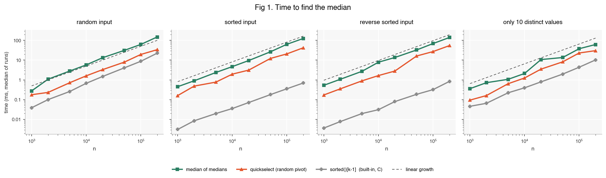
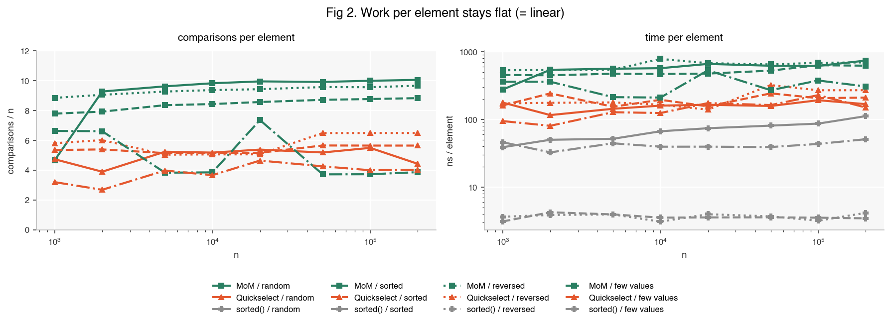
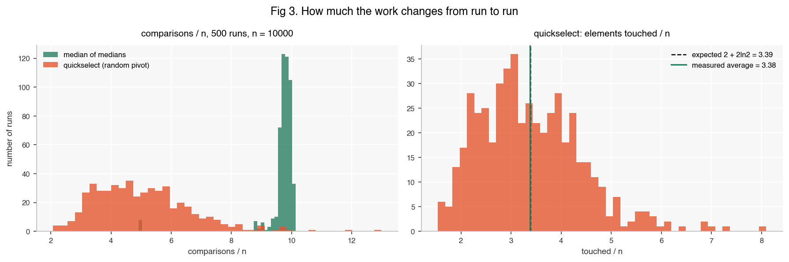
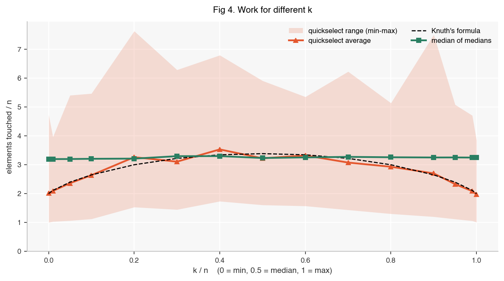
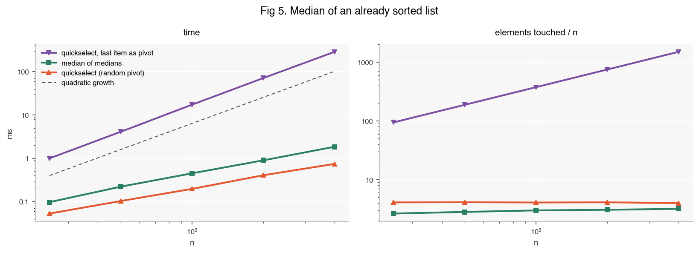
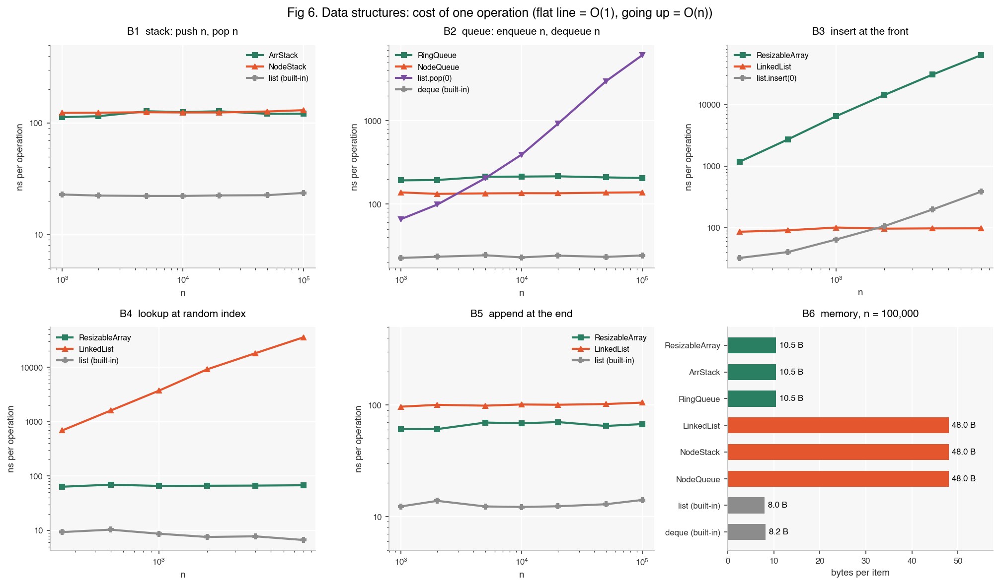

# Assignment 6 Report: Selection Algorithms and Elementary Data Structures

MSCS532 - Algorithms and Data Structures

All measurements were taken on my Apple Silicon MacBook with Python 3.13.9. The raw output is in
[`results/log.txt`](results/log.txt) and the numbers in the tables below are copied from there.
Running `python3 benchmark.py` again will give the same comparison counts (everything random is
seeded, seed = 77) but the times will be a little different each run.

**Contents**

- Part 1: Selection
  - 1. How I implemented it
  - 2. Time and space analysis
  - 3. Experiments
- Part 2: Data structures
  - 4. How I implemented them
  - 5. Complexity of the operations
  - 6. Arrays vs linked lists for stacks and queues
  - 7. Other scenarios
  - 8. Where these get used in practice
- 9. Conclusion
- 10. References

---

## Part 1: Selection

The goal is to find the k-th smallest element (the k-th order statistic) of an unsorted list.
The obvious way is to sort and then index, which is O(n log n). Both algorithms below get it down
to O(n). Median of medians guarantees it, quickselect gets it on average.

### 1. How I implemented it

Everything is in [`selection.py`](selection.py). I based it on SELECT and RANDOMIZED-SELECT from
CLRS chapter 9. k starts at 1 like in the book (k = 1 is the minimum), but the code itself uses
0-based indexes and inclusive ranges `[left, right]`.

| function | how the pivot is picked | running time |
|---|---|---|
| `select_mom(seq, k)` | median of the medians of groups of 5 | O(n) worst case |
| `select_random(seq, k)` | random element of the current range | O(n) expected, O(n²) worst |
| `select_last_pivot(seq, k)` | always the last element (only for comparison) | O(n²) on sorted input |
| `median(seq)` | calls one of the first two with k = ceil(n/2) | |

All of them can take a `WorkLog` object which counts comparisons, how many elements the
partition step touched, the number of passes, and the recursion depth. I used it to get
machine-independent numbers for the experiments.

#### 1.1 Partitioning into three parts

The partition is the same for all three functions:

```python
def partition3(arr, left, right, pivot):
    lo_ptr = scan = left
    hi_ptr = right
    while scan <= hi_ptr:
        cur = arr[scan]
        if cur < pivot:
            arr[lo_ptr], arr[scan] = cur, arr[lo_ptr]
            lo_ptr += 1; scan += 1
        elif pivot < cur:
            arr[scan], arr[hi_ptr] = arr[hi_ptr], cur
            hi_ptr -= 1
        else:
            scan += 1
    size = right - left + 1
    return lo_ptr, hi_ptr, 2 * size - (lo_ptr - left)
```

This is the "Dutch national flag" partition. At the end, everything before `lo_ptr` is smaller
than the pivot, `arr[lo_ptr..hi_ptr]` equals the pivot, and everything after `hi_ptr` is bigger.
It's one pass with O(1) extra space. The comparison count can be computed at the end: a smaller
element needs one `<` check and anything else needs two, so it's `2*size - (number smaller)`.

I went with three parts instead of the textbook's two mainly because of duplicates:

- If k lands inside the "equal" block, that value is the answer and the loop can stop. With
  only a few distinct values this ends the search very quickly (see 3.3).
- The worst-case proof for median of medians depends on having roughly 3n/10 elements on each
  side of the pivot. If there are lots of copies of the pivot value and the partition is
  two-way, all the copies end up on one side. An extreme example is a list where every value is
  the same: one side gets n-1 elements every time and the "linear" algorithm becomes quadratic.
  With three parts, the copies go in the middle and get thrown away, so the proof still works.

#### 1.2 Median of medians

```python
def _mom(arr, left, right, want, log, depth):
    while True:
        size = right - left + 1
        if size <= 5:
            small_sort(arr, left, right)
            return arr[want]
        dest = left
        for g_start in range(left, right + 1, 5):          # groups of 5
            g_end = min(g_start + 4, right)
            small_sort(arr, g_start, g_end)
            g_mid = (g_start + g_end) // 2
            arr[dest], arr[g_mid] = arr[g_mid], arr[dest]  # median to the front
            dest += 1
        n_meds = dest - left
        pivot = _mom(arr, left, dest - 1, left + (n_meds - 1) // 2, log, depth + 1)
        eq_start, eq_end, _ = partition3(arr, left, right, pivot)
        if want < eq_start:   right = eq_start - 1
        elif want > eq_end:   left = eq_end + 1
        else:                 return pivot
```

(I removed the WorkLog lines here to keep it short.) Some decisions I made:

- The group medians are moved to the front of the range rather than copied into a new list.
  This works because `dest` moves by 1 per group and `g_start` moves by 5, so `dest` is always
  behind and only overwrites groups that are already done.
- The final step (continue into whichever side has k) is a `while` loop instead of a
  recursive call. The only real recursion is for finding the pivot, which is on a list 5 times
  smaller, so the call stack stays around log5(n) deep.
- Groups are sorted with insertion sort. 5 elements need at most 10 comparisons, so this is
  constant time per group.
- If the last group has fewer than 5 elements I just take its lower median. The proof already
  has a "-6" term that covers this.

#### 1.3 Quickselect

```python
def _qselect(arr, want, pick_pivot, log):
    left, right = 0, len(arr) - 1
    while left < right:
        pivot = arr[pick_pivot(left, right)]   # rng.randint(left, right)
        eq_start, eq_end, c = partition3(arr, left, right, pivot)
        if want < eq_start:   right = eq_start - 1
        elif want > eq_end:   left = eq_end + 1
        else:                 break
    return arr[want]
```

This is basically Hoare's FIND algorithm from 1961 with a random pivot. It's a plain loop, so no
recursion and O(1) extra space. `select_last_pivot` is the same loop but `pick_pivot` always
returns `right`.

#### 1.4 Edge cases and other details

- The input list isn't modified by default (the functions work on `list(seq)`). `copy=False`
  skips the copy and lets the function rearrange your list. As a side effect, the answer then
  ends up at index k-1.
- Only `<` is used on the values, so it works for ints, floats, strings, tuples and so on.
- An empty list or k outside 1..n raises `ValueError`. A k that isn't an int (including `True`)
  raises `TypeError`.
- [`test_selection.py`](test_selection.py) has 20 tests. They try every k on lists of many
  sizes (including 5/6 and 25/26 where the group logic changes), lists full of duplicates, a list
  where all values are equal, sorted and reversed lists, and floats, strings and tuples. There
  are also tests for the analysis itself: work under 20n on five kinds of input, recursion depth
  of at most log5(n)+1, and the last-pivot version being quadratic on sorted input while the
  random one isn't.

### 2. Time and space analysis

#### 2.1 Why median of medians is O(n) even in the worst case

Call the pivot x (the median of the ⌈n/5⌉ group medians). At least half of the groups have a
median that is ≥ x. Each of those groups has at least 3 elements ≥ x (the median and the two
above it), except maybe x's own group and the last short group. So:

    number of elements >= x  >=  3 * (ceil(ceil(n/5) / 2) - 2)  >=  3n/10 - 6

That means at most 7n/10 + 6 elements are strictly less than x, and by the same argument at most
7n/10 + 6 are strictly greater. Since the three-way partition only ever continues into the
"less" part or the "greater" part (the equal part ends the search), the next range is never
bigger than 7n/10 + 6. This works for any input, duplicates included.

Adding up the cost of each step:

| step | cost |
|---|---|
| sort ⌈n/5⌉ groups of 5 | O(n) |
| recursive call to find the median of medians | T(n/5) |
| partition | O(n) |
| continue into one side | at most T(7n/10 + 6) |

    T(n) <= T(n/5) + T(7n/10 + 6) + a*n

To show it's linear, assume T(n) ≤ cn and plug it in:

    T(n) <= c(n/5 + 1) + c(7n/10 + 6) + a*n = 9cn/10 + 7c + a*n

This is ≤ cn as long as cn/10 - 7c ≥ an, which is true for n ≥ 140 if c ≥ 20a (for smaller n we
can just pick c big enough). What makes it work is that 1/5 + 7/10 = 9/10 is less than 1. Both
recursive calls together handle less than the full input, so each level of the recursion does
less work than the one above (n, 0.9n, 0.81n, ...) and the total is at most about 10 times the
first level. If you used groups of 3 instead, it would be 1/3 + 2/3 = 1, every level would cost
n, and you'd end up with O(n log n).

In practice the constant is pretty big. Insertion sort on 5 random values needs about 7.7
comparisons on average (1 + 5/3 + 9/4 + 14/5), which is around 1.5 per element. The partition
adds another ~1.5 per element. And this happens again at every level of both recursions. Across
500 random inputs, `select_mom` used 9.7 comparisons per element on average, while quickselect
used about 5.0 (section 3.4).

Space: every call uses O(1) extra, and the recursion is only through the pivot step, so the stack
is about log5(n) deep. With n = 100,000 my WorkLog recorded a depth of 7 (log5(100000) is about
7.2). The input copy is another O(n), unless you pass `copy=False`.

#### 2.2 Why quickselect is O(n) on average

Since the pivot is picked uniformly at random, its rank q among the m elements in the current
range is uniform on 1..m, and this doesn't depend at all on how the input is ordered. After the
partition, at most max(q-1, m-q) elements are left. Following CLRS 9.2:

    E[T(n)] <= (1/n) * sum over q of E[T(max(q-1, n-q))] + a*n
            <= (2/n) * sum_{j = n/2}^{n-1} E[T(j)] + a*n

Assuming E[T(j)] ≤ cj gives E[T(n)] ≤ c(3n/4 + 1/2) + an, which is ≤ cn when
n(c/4 - a) ≥ c/2. That holds for any c > 4a once n is large enough. So E[T(n)] = O(n).

A more intuitive way to see it: half the time the pivot lands in the middle half of the values,
and when that happens at least a quarter of the range gets removed. So it takes about 2 passes on
average to shrink the range to 3/4 of its size. That gives roughly
2n(1 + 3/4 + (3/4)² + ...) = 8n, which is a loose bound but clearly linear.

Knuth (1971) worked out the exact expected number of elements the partitions go over:

    E[C(n,k)] ≈ 2n + 2k ln(n/k) + 2(n-k) ln(n/(n-k))

This is 2n when looking for the minimum or maximum and is largest at the median, where it's
2n(1 + ln 2) ≈ 3.386n. In my experiment the average over 500 runs was 3.377n.

The worst case is still O(n²), for example if every pivot happened to be the largest remaining
element. But with random pivots that's extremely unlikely. Each pass has at least a 1/2 chance of
cutting the range to 3/4 or less, so the chance of needing many more passes than expected drops
off exponentially. Out of 500 runs, the worst one touched 8.1n elements, about 2.4 times the
average. And since the pivot doesn't depend on the input, there's no particular input that makes
it slow.

Space: O(1) because it's a loop, plus the O(n) copy if you don't turn it off.

#### 2.3 Fixed pivot, for comparison

If the pivot is always `arr[right]` and the list is sorted, the pivot is always the largest
element left. To find the median it has to remove one element per pass for n/2 passes, touching
about 3n²/8 elements in total. My measurement at n = 4000 was exactly 1500.8n touched, and
3·4000/8 = 1500. Sorted or nearly sorted input happens a lot in real data, which is why nobody
uses a fixed pivot.

#### 2.4 Summary

| | median of medians | quickselect |
|---|---|---|
| worst case | O(n) | O(n²), but very unlikely |
| average | O(n) | O(n) |
| comparisons per element (random input, median) | about 9.7 to 10 | about 5 on average |
| variation between runs | small | sd about 1.6n comparisons |
| extra space | O(log n) stack | O(1) |
| other overhead | sorting groups, extra recursion, swapping medians | one `randint` call per pass |
| depends on input order? | no | no |
| how hard to write | more fiddly | about 10 lines |

---

### 3. Experiments

#### 3.1 Setup

- n from 1,000 to 200,000. Four kinds of input: random integers in [0, 10n), sorted, reversed,
  and "few values" (random integers 0 to 9). k is always the lower median, which is the most
  expensive k for quickselect.
- Each time is the median of 5 runs with the garbage collector turned off. Quickselect uses a
  different seed for each run. The time includes the input copy for every algorithm so the
  comparison is fair.
- I also timed `sorted(data)[k-1]` as a reference point. That's Timsort, implemented in C.
- Comparison counts come from WorkLog, so they don't depend on how fast the machine is.





#### 3.2 Both are linear

In Figure 1 (log-log scale) both algorithms run parallel to the linear guide line for every kind
of input. Figure 2 shows it more directly: comparisons per element and time per element stay
roughly flat while n grows by a factor of 200. Random input:

| n | MoM | cmp/n | Quickselect | cmp/n | sorted() |
|---:|---:|---:|---:|---:|---:|
| 1,000 | 0.28 ms | 4.67 | 0.18 ms | 4.73 | 0.04 ms |
| 10,000 | 5.71 ms | 9.82 | 1.60 ms | 5.18 | 0.67 ms |
| 100,000 | 61.7 ms | 9.99 | 19.2 ms | 5.49 | 8.7 ms |
| 200,000 | 147.9 ms | 10.05 | 33.7 ms | 4.42 | 22.4 ms |

Going from 100k to 200k a bit more than doubles MoM's time and a bit less than doubles
quickselect's, which is about what you'd expect with timing noise. Median of medians was usually
3 to 4.5 times slower than quickselect, with a few points closer to 2x. That matches the larger
constant from section 2.1: roughly double the comparisons, plus the extra group sorting and the
second recursion.

The n = 1,000 MoM point (4.67 cmp/n) is low because one of the early pivots happened to be the
median itself, which ends the search early. For larger n the MoM count settles around 10. The
quickselect numbers jump around more (4.4 to 5.5) because each point is only 5 random runs.

#### 3.3 Different input types

| input (n = 200,000) | MoM | cmp/n | Quickselect | cmp/n |
|---|---:|---:|---:|---:|
| random | 147.9 ms | 10.05 | 33.7 ms | 4.42 |
| sorted | 124.5 ms | 8.83 | 42.1 ms | 5.65 |
| reversed | 139.2 ms | 9.66 | 54.1 ms | 6.49 |
| few values | 61.4 ms | 3.86 | 30.1 ms | 4.02 |

- Neither one gets slow on sorted or reversed input, which is the whole point of both designs.
  The last-pivot version on the other hand is about 390 times slower on sorted input already at
  n = 4,000 (section 3.6).
- Quickselect's counts on sorted/reversed are a little higher here than on random input, but
  they're well within its normal run-to-run spread (section 3.4 has a standard deviation of
  1.6n). It's not a trend; the order of the input doesn't affect a random pivot.
- MoM is slightly cheaper on sorted input (8.8 vs 10 comparisons per element). Its groups of
  five are already in order there, so insertion sort only needs 4 comparisons per group
  instead of about 7.7.
- Few distinct values helps both, MoM the most (3.9 vs 10). With 10 values, the median value
  takes up about 10% of the list. After one or two passes k is inside the "equal" block and the
  search stops. A two-way partition would keep going through all those copies.

#### 3.4 Variation between runs

500 runs at n = 10,000, with a new random list (and a new quickselect seed) every time:

| | cmp/n avg | sd | min | max | touched/n avg |
|---|---:|---:|---:|---:|---:|
| MoM | 9.696 | 0.644 | 4.918 | 10.133 | 3.145 |
| Quickselect | 5.027 | 1.567 | 2.067 | 12.991 | 3.377 (theory 3.386) |



This is what "worst case" vs "expected" looks like in practice. MoM almost always lands between
9.5n and 10.1n comparisons (the few low ones are runs where an early pivot was the answer).
Quickselect is about twice as cheap on average but its standard deviation is 2.4 times bigger,
and its worst run (13.0n) was actually worse than MoM's worst. The average number of elements
touched, 3.377n, is within 0.3% of Knuth's 2 + 2 ln 2 = 3.386.

#### 3.5 Different values of k

For each k I ran quickselect 100 times on the same random list of 50,000 elements:



The quickselect average follows Knuth's formula pretty closely: 2.01n at k = 1 (theory 2.00),
3.22n at the median (theory 3.39) and 1.97n at k = n (theory 2.00). The biggest gap was about
0.26n at k/n = 0.2, which is reasonable for 100 runs given how wide the min-max band is. Median
of medians stays at about 3.2n elements touched (about 10n comparisons) no matter what k is,
because it picks its pivot without looking at k. So if you only need something close to the
min or max, quickselect is even further ahead, and a simple linear scan (n-1 comparisons) beats
both of them for the actual min/max.

#### 3.6 What the random pivot gets you

Median of a sorted list, three pivot rules:

| n | last pivot | touched/n | quickselect | touched/n | MoM | touched/n |
|---:|---:|---:|---:|---:|---:|---:|
| 250 | 1.00 ms | 94.5 | 0.05 ms | 4.11 | 0.10 ms | 2.65 |
| 1,000 | 17.3 ms | 375.8 | 0.20 ms | 4.09 | 0.45 ms | 3.00 |
| 4,000 | 287.4 ms | 1500.8 | 0.74 ms | 3.99 | 1.85 ms | 3.19 |



For the last-pivot version, touched/n grows linearly with n (it's exactly 3n/8, as worked out in
2.3), and the time roughly quadruples every time n doubles. That's quadratic. The other two stay
flat.

#### 3.7 Comparing with sorted()

The surprising result is that the built-in `sorted()` beats both of my linear-time functions at
every size I tried: 22.4 ms vs 33.7 ms (quickselect) vs 147.9 ms (MoM) on 200,000 random
numbers. On sorted input, Timsort notices the list is one long run and finishes in under a
millisecond. This doesn't break the theory. Big-O ignores constant factors, and here the
constant includes the gap between interpreted Python and compiled C, which is something like
50-100x per operation. You can still see the log n factor: Timsort's time per element on random
data goes from 39 ns up to 112 ns over the range I tested, while quickselect's stays around
115-190 ns without any upward trend. For big enough n the lines would cross. In C++,
`std::nth_element` (which is introselect) is faster than sorting at basically any size.

#### 3.8 Theory vs what I measured

| expected | measured |
|---|---|
| both linear | flat time/n and comparisons/n over a 200x range of n, all inputs |
| MoM doesn't care about input order or k | 8.8-10 cmp/n for every ordering, ~3.2n touched for every k |
| quickselect doesn't care about input order | 4.4-6.5 cmp/n on random/sorted/reversed, inside its normal spread |
| quickselect averages 2n(1+ln2) at the median | 3.377n vs 3.386n |
| quickselect follows Knuth's formula in k | within about 0.26n at every k |
| MoM has a bigger constant | 2-5x slower (mostly 3-4.5x), ~2x the comparisons |
| only MoM is guaranteed | sd 0.64n vs 1.57n |
| last pivot is O(n²) on sorted input | touched exactly 3n²/8 |
| MoM recursion depth is log5(n) | 7 at n = 100,000 |

So which one should you use? Quickselect is simpler and usually 3-4 times faster, so it's the
better default. Median of medians makes sense when you really need a worst-case guarantee, like
in real-time code or when someone could feed you inputs designed to be slow. Libraries usually
combine them ("introselect"): run quickselect, and only switch to median of medians if it isn't
making enough progress.

---

## Part 2: Data structures

### 4. How I implemented them

The code is in [`data_structures.py`](data_structures.py) and the tests are in
[`test_data_structures.py`](test_data_structures.py) (21 tests). Several tests do a few thousand
random operations on my structure and on a normal Python list side by side, and check they agree
after every operation.

| class | how it's stored | notes |
|---|---|---|
| `ResizableArray` | fixed block of slots + a count | doubles when full, halves when only 1/4 used; insert/delete shift elements by hand |
| `Matrix` | one flat row-major block, (r, c) is at r·cols + c | O(1) access; add/drop rows and columns, transpose, +, @ |
| `ArrStack` | block + top index | push/pop at the end, nothing ever shifts |
| `RingQueue` | circular buffer: block + front index + count | back = (front + count) % cap; when it grows the contents are unwrapped |
| `LinkedList` | `ListNode(val, nxt)` with head, tail and count | tail pointer for O(1) add_back, `insert_after(node)` for O(1) splicing, in-place reverse |
| `NodeStack` / `NodeQueue` | linked nodes | stack pushes at the head; queue adds at the tail and removes at the head |
| `GeneralTree` | `TreeNode(val, parent, first_child, next_sibling)` | left-child/right-sibling from CLRS 10.3, so 3 links per node no matter how many children |

I wanted these to be actually "from scratch", so the array classes only use Python's list to
grab a fixed block of memory once (`[None] * cap`). After that they just read and write single
slots by index. Growing, shrinking, shifting, and the wrap-around in the queue are all in my
code; I never call `list.append`, `insert` or `pop` on the block. That makes the timings honest:
when `ResizableArray.insert(0, x)` is O(n), it's because of a loop you can see in the file.
Removed slots get reset to `None` so the structure doesn't keep old objects alive.

The tree traversals (`preorder`, `height`, `bfs`, `find`) use my own `ArrStack` and `NodeQueue`
instead of recursion. One test builds a chain 5,000 nodes deep (Python's default recursion limit
is 1,000) and it works fine.

### 5. Complexity of the operations

| structure | access / peek | insert | delete | search | space |
|---|---|---|---|---|---|
| ResizableArray | O(1) | append O(1) amortized, at i O(n-i) | pop O(1) amortized, at i O(n-i) | O(n) | O(n), at most 4n slots |
| Matrix (r x c) | O(1) | row/col O(rc) | row/col O(rc) | O(rc) | O(rc) |
| ArrStack | O(1) | push O(1) amortized | pop O(1) | - | O(n) |
| RingQueue | O(1) | enqueue O(1) amortized | dequeue O(1) | - | O(n) |
| LinkedList | get(i) O(i) | front/back O(1), after a node O(1), at i O(i) | front O(1), back O(n), at i O(i) | O(n) | O(n) nodes |
| NodeStack | O(1) | O(1) | O(1) | - | O(n) |
| NodeQueue | O(1) | O(1) | O(1) | - | O(n) |
| GeneralTree | parent O(1), children O(d) | add_child O(d) | cut O(d + subtree size) | O(n) | O(n) |

(d = number of children the parent has)

Why appends are O(1) amortized with doubling: starting at capacity 4, n appends copy
4 + 8 + 16 + ... + n < 2n elements in total during resizes. Add the n normal writes and it's less
than 3n work overall, so O(1) per append on average. Another way to think about it is to charge
3 units per append: 1 for writing it, and 2 saved up to pay for copying it and one older element
at the next resize. If the array grew by a fixed amount instead of doubling, the total would be
O(n²).

Why shrink at 1/4 and not 1/2: if the array halved as soon as it was half empty, then
alternating append/pop right at the boundary would resize (and copy everything) on every single
operation. Shrinking at 1/4 full down to half capacity leaves the array half full after any
resize, so at least n/4 operations have to happen before the next resize. That keeps everything
O(1) amortized and the array is never less than 1/4 full, so space stays O(n).

Why `pop_back` is O(n) on a singly linked list: to remove the tail you need to set the
second-to-last node's `nxt` to None, and the only way to find that node is to walk from the
head. A doubly linked list fixes this with a `prev` pointer, at the cost of one more pointer per
node. It's also why `NodeQueue` removes from the head and adds at the tail and not the other way
around.

### 6. Arrays vs linked lists for stacks and queues



**Stacks** (B1: push n, then pop n)

| n | ArrStack | NodeStack | list (built-in) |
|---:|---:|---:|---:|
| 1,000 | 113 ns/op | 123 ns/op | 23 ns/op |
| 100,000 | 121 ns/op | 130 ns/op | 24 ns/op |

Both are flat (O(1) per operation) and pretty much tied on speed. The differences are in other
places:

- Worst case for one operation: NodeStack's push is always O(1). ArrStack's is O(1) amortized,
  but the push that triggers a resize copies everything. That only matters if you can't afford
  an occasional slow operation, like in an interrupt handler.
- Memory (B6): 10.5 bytes per item for the array versions vs 48 bytes for the linked versions,
  about 4.6x more. A `ListNode` is a whole Python object (object header, GC header and two
  pointer slots). An array slot is a single 8-byte pointer, plus some empty capacity (at
  n = 100,000 the block has 131,072 slots and is 76% full, so 8 / 0.76 ≈ 10.5).
- Cache behaviour: array slots are next to each other in memory, linked nodes are spread around
  the heap. In Python the interpreter overhead hides this, but in C walking an array is often
  several times faster than walking a linked list just because of that.
- The built-in list is about 5x faster than both, but only because it's written in C. Internally
  it's an array stack, same idea as ArrStack.

**Queues** (B2: enqueue n, then dequeue n)

| n | RingQueue | NodeQueue | list.pop(0) | deque (built-in) |
|---:|---:|---:|---:|---:|
| 1,000 | 192 ns/op | 138 ns/op | 66 ns/op | 23 ns/op |
| 10,000 | 214 ns/op | 135 ns/op | 392 ns/op | 23 ns/op |
| 100,000 | 205 ns/op | 138 ns/op | 6,104 ns/op | 24 ns/op |

- Using a plain list with `pop(0)` as a queue is quadratic. Every dequeue moves all the
  remaining elements down one slot, so it's O(n) each, and 100,000 operations took 0.61 s
  instead of about 20 ms. For small n it looks fast because the shifting is a C `memmove`, but
  the cost per operation keeps growing (66, 392, 6,104 ns). The circular buffer fixes this,
  since the front and back indexes just move forward and wrap around.
- Ring vs linked: both flat, but in Python the linked one is about 1.5x faster. The ring buffer
  has to do a `%` and a `len()` every time, while the linked queue just changes a couple of
  pointers. In C I'd expect the ring buffer to win (better locality, no allocation per item),
  and it uses 4.6x less memory either way.
- `collections.deque` is the fastest. It's a doubly linked list of 64-slot blocks written in C,
  so it gets O(1) at both ends with no shifting and still has array-like memory use (8.3 bytes
  per item). That's what I'd actually use for a queue in Python.

**Summary of the trade-offs**

| | array based | linked |
|---|---|---|
| push/pop/enqueue/dequeue | O(1) amortized | O(1) always |
| memory per item (measured) | ~8-16 bytes | 48 bytes |
| locality | contiguous, cache friendly | scattered |
| allocation | rare, but each resize copies everything | one small allocation per item |
| max size | has to grow (or be fixed up front) | only limited by memory |
| ease of implementation | stack is trivial, queue needs the wrap-around math | both easy, but it's easy to forget to update tail |

### 7. Other scenarios

**Inserting at the front (B3).** `ResizableArray.insert(0, x)` shifts all n elements, so n
inserts take O(n²). At n = 8,000 that was 507 ms (63,413 ns per insert and still going up),
compared to 0.78 ms (98 ns, flat) for `LinkedList.add_front`, about 650 times slower. Even the
C version, `list.insert(0)`, is O(n) per insert: it went from 32 to 384 ns per operation and was
slower than my Python linked list once n got past about 2,000.

**Looking up by index (B4).** Here it's the other way around. `ResizableArray[i]` stays at about
67 ns, but `LinkedList.get(i)` has to walk i nodes: 35,608 ns per lookup at n = 8,000, roughly
520 times slower, and it keeps growing with n. Anything that needs random access (binary search,
heaps, hashing, the selection algorithms from part 1) needs an array.

**Appending (B5).** Both O(1): about 65-70 ns for the array (amortized) and about 100 ns for the
linked list. The array is faster because it doesn't create a new object for every element.

**Memory (B6).** Array based: 10.5 bytes per item. Linked: 48 bytes. Built-in list/deque: 8.0 /
8.3 bytes. If you're storing millions of small values, a linked structure in Python can use way
more memory than the data itself.

**Matrices.** Storing row by row makes `m[r, c]` O(1) and going along a row reads consecutive
slots. Changing the shape is O(rc), so it's best for data with a fixed shape like images,
adjacency matrices and linear algebra. In `__matmul__` I used the i-k-j loop order so the inner
loop goes along rows of both B and the result, which is the cache friendly order for row-major
storage.

### 8. Where these get used in practice

| structure | examples | why |
|---|---|---|
| arrays / dynamic arrays | Python list, C++ vector, Java ArrayList, the storage under heaps, hash tables and strings, lookup tables | O(1) indexing, compact, cache friendly |
| matrices | images, adjacency matrices, spreadsheets, game boards, NumPy arrays | O(1) access by row and column, fast row scans |
| stacks | the function call stack, undo/redo, browser back button, checking brackets, evaluating expressions, DFS, backtracking | last in, first out |
| queues | BFS, CPU schedulers, print queues, message queues, web server request queues | first come, first served |
| circular buffers | audio/video streaming, keyboard buffers, keeping the last N log lines, network card buffers | fixed memory, no allocation |
| linked lists | LRU cache (hash map + doubly linked list), free lists in memory allocators, adjacency lists for sparse graphs, hash table chaining, Linux kernel lists | O(1) insert/remove when you already have the node, no big resizes |
| rooted trees | file systems, HTML DOM, org charts, parse trees, decision trees | natural hierarchy with any number of children |

When to pick which:

- If you need to look things up by position, use an array. B4 showed a 520x difference with
  just 8,000 items.
- If you insert or delete a lot at the front or in the middle and already have a reference to
  the spot, a linked list is better (B3: about 650x). If you'd have to search for the spot first,
  that walk is O(n) anyway and the advantage mostly goes away.
- For memory, arrays win, about 4.6x less in my measurements, with no per-item allocation.
- If you need every operation to be predictably fast, go with linked (no resize spikes) or a
  fixed-size ring buffer.
- For ease of implementation, an array stack is the simplest thing possible. A linked queue
  avoids the modulo math of a ring buffer. In real Python code I'd just use `list` as a stack and
  `collections.deque` as a queue, since they're these same ideas written in C.
- Never build a queue on `list.pop(0)`.

---

## 9. Conclusion

- Both linear-time selection algorithms behaved the way the theory says. Time per element and
  comparisons per element stayed flat from 1,000 to 200,000 elements on random, sorted,
  reversed and duplicate-heavy input. Quickselect's average of 3.377n elements touched at the
  median was within 0.3% of Knuth's 3.386n, and it followed his formula for other values of k too.
- The difference between a worst-case and an expected-case guarantee showed up mostly as
  variance. Median of medians was very consistent (sd 0.64n) but used about twice as many
  comparisons and was usually 3-4.5x slower. Quickselect was faster on average but its spread
  was 2.4x wider. The last-pivot version really is quadratic on sorted input (exactly 3n²/8).
- The three-way partition is what keeps median of medians linear when there are duplicates, and
  it turned the few-distinct-values case into the fastest case instead of a slow one.
- Constant factors matter. C's O(n log n) Timsort still beat both pure-Python O(n) algorithms at
  every size I tested.
- Arrays vs linked lists comes down to the access pattern. Arrays were much better for index
  lookups (~520x), appends and memory (4.6x smaller). Linked lists were much better for inserting
  at the front (~650x). For stacks they were basically tied. For queues the naive array version
  is quadratic, and both the ring buffer and the linked queue fix that.

## 10. References

- Blum, M., Floyd, R. W., Pratt, V., Rivest, R. L., & Tarjan, R. E. (1973). Time bounds for
  selection. *Journal of Computer and System Sciences, 7*(4), 448-461.
- Cormen, T. H., Leiserson, C. E., Rivest, R. L., & Stein, C. (2022). *Introduction to
  algorithms* (4th ed.). MIT Press. Ch. 9 and 10, and section 16.4 on dynamic tables.
- Dijkstra, E. W. (1976). *A discipline of programming*. Prentice-Hall.
- Hoare, C. A. R. (1961). Algorithm 65: Find. *Communications of the ACM, 4*(7), 321-322.
- Knuth, D. E. (1971). Mathematical analysis of algorithms. *Proceedings of IFIP Congress 71*,
  19-27.
- Musser, D. R. (1997). Introspective sorting and selection algorithms. *Software: Practice and
  Experience, 27*(8), 983-993.
- Python Software Foundation. *collections - Container datatypes*.
  https://docs.python.org/3/library/collections.html
